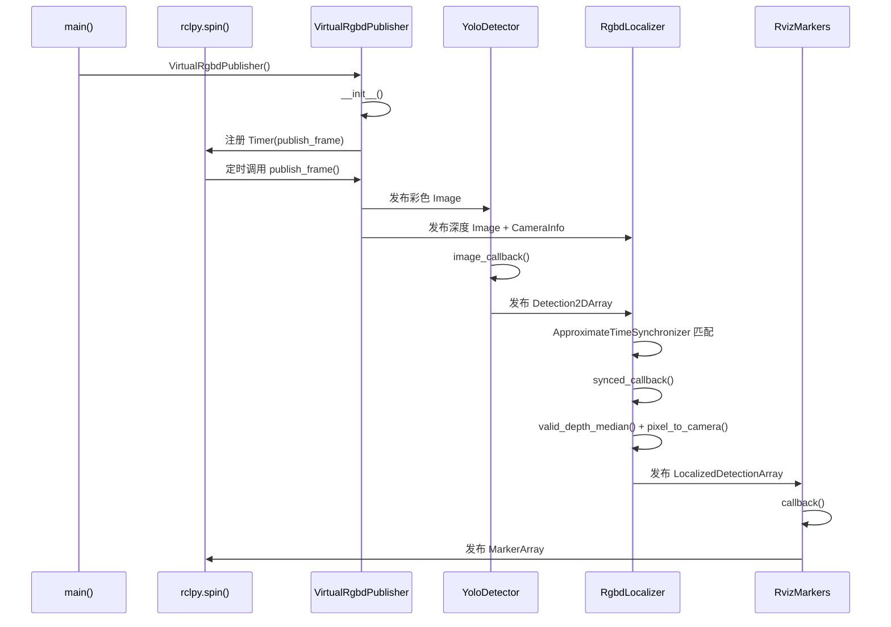
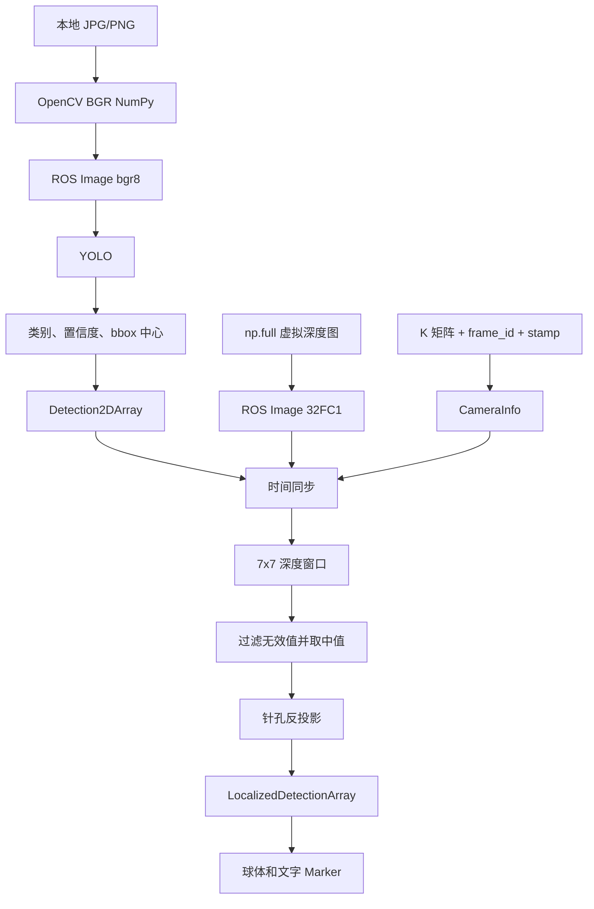

# 项目一：基于 ROS2、YOLO 与 RGB-D 的桌面目标检测及三维定位系统

> 这是一份项目全景笔记：把项目的**目的、原理、架构、进展、问题、决策和路线图**集中在一处。
> 内容整理自项目上下文包（`raw/project_context_package.md`，生成时点 2026-09-12），保留原文的【事实】【推断】【风险】标注，并对关键技术概念补充了原理解释。
>
> **阅读顺序建议**：想快速了解 → 读第 0 章「一页速览」；想理解原理 → 读第 2 章「核心原理」；想了解当前状态和坑 → 读第 5、7 章。

> [!warning] 事实边界（最重要的一条）
> 当前系统**没有真实 RGB-D 相机、没有机械臂**，深度图是**虚拟数据**。项目**不能**宣称已完成真实三维定位或抓取。所有"三维定位"结果都只是相机光学坐标系下的计算结果，不是经过实测验证的物理量。这条边界贯穿全文，必须时刻牢记。

---

## 0. 一页速览

### 项目一句话总结

【事实】这是一个使用 ROS2、YOLO 和 RGB-D 数据识别桌面 `cup`、`book`、`pen`，并输出目标在**相机光学坐标系**下三维位置的视觉原型系统。

### 项目目的

【事实】建立一条**可替换输入、可测试、可可视化**的机器人视觉感知链路，为后续接入真实 RGB-D 相机、桌面坐标标定和机械臂抓取做准备。

> [!info] 为什么"可替换输入"是核心设计目标
> 项目从一开始就把"输入源"设计成可插拔的（虚拟发布器 ↔ 真实相机共用同一套话题）。这样做的价值是：在硬件未到位时就能把**数据流、消息接口、几何算法**全部跑通和验证，等相机到位只需替换发布节点，下游的检测、定位、可视化逻辑一行不用改。这是典型的**面向接口编程**思想在机器人系统中的应用。

### 当前状态

【事实】ROS2 虚拟 RGB-D 主链路**已经实现**：

```text
虚拟输入 → YOLO 二维检测 → RGB-D 深度反投影 → 自定义三维检测消息 → RViz Marker
```

【事实】当前没有真实 RGB-D 相机、没有机械臂，深度图是虚拟数据。

【事实】当前模型为 `desktop_detection_v3.pt`，离线测试记录为 `mAP50=0.9826`、`mAP50-95=0.8546`。

【事实】Git 分支为 `main`，远程为 `https://github.com/2X7V14N/ros2-yolo-rgbd-desktop-localization.git`，最近提交为 `d092e70`。当前工作区存在未提交的 `geometry.py` 修改。

### 核心原理（一句话）

【事实】使用**针孔相机反投影**：

```text
X = (u - cx) * Z / fx
Y = (v - cy) * Z / fy
Z = depth(u, v)
```

深度从检测框中心附近窗口中筛选有效值后取**中值**，再与 `CameraInfo.K` 中的内参结合计算相机坐标。

### 核心流程

```text
虚拟彩色图/深度图/CameraInfo
    -> Detection2DArray
    -> 有效深度窗口
    -> 像素反投影
    -> LocalizedDetectionArray
    -> RViz MarkerArray
```

### 当前最大阻塞

【事实】真实 RGB-D 相机尚未到位，无法完成真实深度测量、深度对齐验证、真实内外参标定和真实定位误差实验。

【风险】当前 `geometry.py` 的练习代码被追加在**模块顶层**，导入模块时会执行打印并产生副作用；需要在下一次代码整理时移入独立练习脚本或 `if __name__ == "__main__":` 块。

> [!info] 什么是"模块顶层副作用"
> Python 中，`import module` 会执行模块里**所有顶层语句**。如果练习代码（如 `result2 = ...; print(result2)`）写在了函数外面，那么任何 `import geometry` 的地方——包括 ROS2 节点和测试——都会在导入瞬间打印这些内容。正确的做法是把练习代码放进 `if __name__ == "__main__":` 块里，这样只有直接运行该文件时才执行，被导入时不执行。

### 下一步最优先事项

1. 保留并完成当前学习练习，但不要把练习变量放在正式库模块顶层。
2. 修复 `scripts/inference_json.py` 中缺失的 `PROJECT_ROOT` 定义。
3. 将 ROS2 参数文件中的 `device: "0"` 改为可移植的 `auto`，或明确使用参数覆盖。
4. 为四节点链路增加可复现的 ROS2 集成测试和输入异常测试。
5. 相机到位后优先验证深度单位、彩色/深度对齐、内参和坐标系，再做真实误差评估。

---

## 1. 项目目的与背景

### 1.1 为什么做这个项目

【事实】面向机器人视觉、计算机视觉和 ROS2 相关秋招，系统学习并完善一个可解释、可展示的项目。

【事实】项目最初由 AI 辅助生成，目标是从零理解源码、数据流、技术难点和不足，而不是只会运行命令。

### 1.2 解决的问题

【事实】系统识别桌面上的三类目标，并将二维像素检测与深度信息结合，输出相机坐标系下的三维点。

【推断】长期应用场景是为机器人提供目标候选位置，未来可能扩展到抓取位姿和机械臂闭环；这些后续功能目前尚未实现。

### 1.3 目标用户和场景

【事实】当前直接用户是项目作者本人，用于学习、求职展示和后续机器人视觉开发。

【推断】未来使用场景为桌面物体感知和机器人操作，但没有材料证明已经有具体机器人型号、机械臂型号或生产部署需求。

### 1.4 成功标准和评价指标

#### 已有指标

| 指标 | 数值 | 适用范围 |
| --- | ---: | --- |
| Precision | 0.9857 | V3 离线二维检测测试集 |
| Recall | 0.9489 | V3 离线二维检测测试集 |
| mAP50 | 0.9826 | V3 离线二维检测测试集 |
| mAP50-95 | 0.8546 | V3 离线二维检测测试集 |
| 平均推理延迟 | 48.70 ms | RTX 3050 Ti、640 输入、单图重复推理 |
| 平均 FPS | 20.54 | 同上，仅模型推理，不是完整 ROS2 延迟 |
| 几何测试 | 6 passed | 上一阶段测试，当前练习代码加入后需重跑 |

#### 尚缺指标

- 真实深度定位 MAE、RMSE、P50、P95；
- 彩色/深度对齐误差；
- 深度有效率和空洞比例；
- 完整 ROS2 端到端延迟；
- 桌面坐标系转换误差；
- 目标姿态误差；
- 抓取成功率。

> [!warning] 检测指标 ≠ 定位精度
> 上表中的 mAP 系列指标衡量的是**二维检测框**的准确度（框得准不准、类别对不对），与"三维位置准不准"是两回事。即使 mAP50 高达 0.98，如果深度是虚拟常量，三维定位仍然没有任何真实精度可言。面试时这一点必须说清楚，否则会被认为不懂指标含义。

### 1.5 非目标

【事实】当前明确**不包含**：真实 RGB-D 相机验证、机械臂控制、抓取规划、抓取执行、抓取闭环和真实机器人坐标变换。

### 1.6 约束

- 当前没有真实相机，必须使用虚拟输入或公开/离线数据。
- 当前没有机械臂，只做感知、定位、评估和可视化。
- 用户是初学者，学习必须按小模块展开，不能只给最终代码。
- 项目需要保持事实边界，不能把虚拟深度写成真实测量。
- 主要环境为 Windows + VS Code + WSL2 + Ubuntu 22.04 + ROS2 Humble + Python 3.10。

---

## 2. 核心原理

本章是笔记的**知识核心**，每个小节都补充了原理解释。

### 2.1 YOLO 二维目标检测

【事实】`yolo_detector.py` 将彩色图转换为 OpenCV/NumPy 图像，调用 Ultralytics YOLO 模型，读取检测框、类别和置信度，发布 `vision_msgs/msg/Detection2DArray`。

模型类别：

```text
0: cup
1: book
2: pen
```

【事实】V3 的离线检测指标来自固定测试集，不等于三维定位精度。

> [!info] YOLO 是什么
> YOLO（You Only Look Once）是**单阶段（one-stage）目标检测**模型族。与两阶段方法（如 R-CNN 系列：先生成候选框，再分类）不同，YOLO 在一次前向传播中直接回归出所有检测框的位置和类别，因此速度极快，适合实时应用。
>
> 它的输出本质是一堆 `(类别, 置信度, bbox)` 三元组。本项目里 `yolo_detector` 只取其中的**类别、置信度和检测框中心像素坐标 `(u, v)`**，把它们打包成 ROS2 消息发出去。详细原理可参考 [[concepts/深度学习/Ch13 计算机视觉|Ch13 计算机视觉]] 的目标检测部分。

### 2.2 RGB-D 数据

RGB-D 表示：

- **RGB**：彩色图像；
- **D**：每个像素对应的深度值。

【事实】真实系统要求**深度图已经对齐到彩色图坐标系**，否则 YOLO 得到的 `(u,v)` 不能在深度图中取到相同物理位置的深度。

> [!info] 为什么"对齐"是前提
> RGB 相机和深度相机（如红外/ToF）在物理上是**两个不同的传感器**，安装位置和视角略有差异。同一个物体在彩色图里的像素位置 `(u,v)`，和它在**原始**深度图里的像素位置并不相同。
>
> "对齐（alignment）"就是通过标定，把深度图重投影到彩色相机的视角下，使得**彩色图和深度图的像素一一对应**。只有对齐之后，才能用 YOLO 检测框的 `(u,v)` 去深度图取同一个物体的深度。如果没对齐，取到的可能是背景或其他物体的深度，导致定位完全错误。
>
> 相关原理见 [[concepts/相机标定与 Homography/Ch04 双目相机与RGB-D相机|Ch04 双目相机与RGB-D相机]]。

### 2.3 针孔相机模型

相机内参矩阵：

```text
K = [ fx  0  cx ]
    [ 0  fy  cy ]
    [ 0   0   1 ]
```

投影关系（三维点 → 像素）：

```text
u = fx * X / Z + cx
v = fy * Y / Z + cy
```

反投影关系（像素 + 深度 → 三维点）：

```text
X = (u - cx) * Z / fx
Y = (v - cy) * Z / fy
Z = depth(u, v)
```

【事实】当前 `pixel_to_camera()` 在 `geometry.py` 中实现了上述反投影，并检查焦距和深度是否为正。

> [!info] 反投影公式是怎么来的
> 由**相似三角形**：三维点投影到成像平面后，横向偏移 `(X, Y)` 与深度 `Z` 的比值，等于像素偏移 `(u-cx, v-cy)` 与焦距 `(fx, fy)` 的比值：
> $$\frac{u-cx}{fx} = \frac{X}{Z}, \qquad \frac{v-cy}{fy} = \frac{Y}{Z}$$
> 两边同乘 `Z` 即得反投影公式。关键洞察：**必须知道深度 `Z` 才能恢复实际长度**——这也是为什么单目相机无法直接测距，而需要 RGB-D 提供 `Z`。
>
> 内参含义：`fx = 物理焦距 / 像素尺寸`，所以单位是**像素**（不是图像宽高）；`cx, cy` 是主点（光轴与成像平面的交点），通常接近图像中心，但应来自标定。
>
> 详细推导见 [[concepts/相机标定与 Homography/Ch01 针孔相机与透视投影|Ch01 针孔相机与透视投影]]。

### 2.4 深度窗口中值

【事实】`valid_depth_median()` 会删除 NaN、无穷值、0、负值和超出 `[min_depth_m, max_depth_m]` 的值，再取中值。

【理由】中值比平均值更不容易受到离群点影响；窗口比单像素更能抵抗深度空洞和噪声。

> [!info] 为什么用"窗口 + 中值"而不是"单像素"
> RGB-D 深度图有两个常见问题：**深度空洞**（某些像素测不到深度，值为 0 或 NaN）和**噪声/离群点**（偶尔出现明显错误的深度值）。
>
> - **用窗口而非单像素**：如果只取检测框正中心那一个像素，一旦它恰好是空洞或噪声，深度就完全错了。改用中心附近的一个小窗口（如 7×7），只要窗口内有一部分像素有效，就能得到合理估计。
> - **用中值而非均值**：均值会被少数极端离群值"拉偏"（比如 10 个真实值 0.5m + 1 个错误值 5m，均值会变成约 0.9m，而中值仍是 0.5m）。中值对离群点天然鲁棒。

### 2.5 坐标系和 `frame_id`

【事实】当前输出坐标属于 `camera_color_optical_frame`，约定为 **X 向右、Y 向下、Z 向前**。

【事实】`frame_id` 只是**坐标系标签**，不会自动完成坐标变换。

如果未来要变换到机器人坐标系，需要：

```text
p_robot = R_robot_camera * p_camera + t_robot_camera
```

并且需要**真实标定**得到的 `R` 和 `t`，不能使用虚拟或拍脑袋参数代替。

> [!info] 光学坐标系为什么是"X 右、Y 下、Z 前"
> 这是计算机视觉领域的历史约定（跟着图像坐标走）：图像坐标 `u` 向右增加、`v` 向下增加，为了和 `(u,v)` 一致，光学坐标系的 X 轴向右、Y 轴向下；Z 轴沿光轴指向场景（向前）。注意这与机器人常用的 `base_link` 坐标系（通常 Z 向上）**方向不一致**，所以跨坐标系使用时必须做旋转，不能直接套用数值。

> [!warning] frame_id 最常见的误解
> 给一个三维点标上 `frame_id: camera_color_optical_frame`，**不会**把这个点转换到那个坐标系里——它只是在说"这个数值是在这个坐标系下表达的"。就像给一个数字贴上"单位：米"的标签，并不会改变这个数字的大小。真正的坐标变换必须由 TF2 或显式的 `R, t` 计算完成。当前项目**没有**做这个变换。

### 2.6 ROS2 事件驱动机制

ROS2 节点**不自动执行所有函数**，只自动执行已经注册的回调：

- `__init__()`：Python 创建对象时自动调用；
- `create_timer(period, callback)`：定时器到期时调用 callback；
- `create_subscription(..., callback, ...)`：收到消息时调用 callback；
- `registerCallback()`：消息同步成功时调用同步回调。

普通辅助函数必须由其他代码显式调用，例如 `publish_frame()` 调用 `create_camera_info()`，`synced_callback()` 调用 `valid_depth_median()` 和 `pixel_to_camera()`。

> [!info] "回调"到底是什么意思
> 传统程序是"我调用函数"（`result = func()`）——执行流程由**我的代码**控制。
>
> ROS2 是**事件驱动**的：你把自己的函数"注册"给某个事件源（定时器、消息订阅），然后进入事件循环（`rclpy.spin()`）。之后**由框架**在合适的时机回头调用你的函数——这个"被回头调用"的函数就叫**回调（callback）**。
>
> 所以初学者常见的困惑"这个函数我没调用，它怎么跑了"，答案是：它被 `create_timer` / `create_subscription` 注册了，由 executor（事件循环）在定时到期或收到消息时触发。**只有注册过的函数才会被自动调用**，普通辅助函数不会。

### 2.7 时间戳同步

【事实】虚拟输入节点为彩色图、深度图和 CameraInfo 使用**同一个时间戳**；YOLO 检测结果复制输入彩色图的 Header。

【事实】定位节点使用 `ApproximateTimeSynchronizer`，当前配置为 `queue_size=10`、`slop=0.1`。

【含义】它将时间相同或足够接近的检测、深度和相机参数绑定成一组，避免使用不同时间的观测计算三维位置。

> [!info] 为什么要"同步"三路消息
> 定位需要**同时**拿到：检测框（来自 `/detections`）、深度图（来自 `/camera/aligned_depth_to_color/image_raw`）、相机内参（来自 `/camera/color/camera_info`）——它们来自三个独立的节点、走三条独立的话题，到达时间有微小差异（网络传输、处理延迟）。
>
> 如果错误地把"这一帧的检测框"和"上一帧的深度图"配对，算出来的三维点就是错的。`ApproximateTimeSynchronizer` 解决的正是这个问题：它维护一个小缓存（`queue_size`），把时间差在 `slop`（这里是 0.1 秒）以内的消息凑成一组，再一起交给回调。只有"足够接近"的三路消息才会触发 `synced_callback()`。

---

## 3. 系统架构与模块

### 3.1 总体架构

```mermaid
flowchart LR
    A[离线彩色图片] --> B[virtual_rgbd_publisher]
    B -->|Image| C[/camera/color/image_raw]
    B -->|Depth Image| D[/camera/aligned_depth_to_color/image_raw]
    B -->|CameraInfo| E[/camera/color/camera_info]
    C --> F[yolo_detector]
    F -->|Detection2DArray| G[/detections]
    G --> H[rgbd_localizer]
    D --> H
    E --> H
    H -->|LocalizedDetectionArray| I[/detections_3d]
    I --> J[rviz_markers]
    J --> K[/detections_3d_markers]
    K --> L[RViz2]
```

### 3.2 ROS2 包

#### `vision_interfaces`

【事实】自定义接口包，使用 `ament_cmake` 和 `rosidl_default_generators` 生成：

- `LocalizedDetection.msg`；
- `LocalizedDetectionArray.msg`。

#### `vision_pipeline`

【事实】Python ROS2 功能包，使用 `ament_python`，包含四个可执行节点：

```text
virtual_rgbd_publisher
yolo_detector
rgbd_localizer
rviz_markers
```

> [!info] 为什么消息要单独做一个包
> ROS2 的消息类型（`.msg`）需要**编译时生成**对应的 C++/Python 代码。如果消息定义和 Python 节点放在同一个包里，就会出现"编译消息需要 `ament_cmake`，而 Python 节点需要 `ament_python`"的构建系统冲突。
>
> 因此惯例是：**消息单独建一个 `ament_cmake` 包**（这里是 `vision_interfaces`），Python 逻辑放 `ament_python` 包（`vision_pipeline`），后者依赖前者。这也是 ROS2 功能包结构的标准做法，可参见 [[concepts/ROS2/Ch05 核心概念：工作空间与功能包|Ch05 核心概念：工作空间与功能包]]。

### 3.3 关键文件地图

| 文件 | 入口/对象 | 作用 | 类型 |
| --- | --- | --- | --- |
| `ros2_ws/src/vision_pipeline/vision_pipeline/geometry.py` | `pixel_to_camera`、`valid_depth_median` | 几何和深度纯函数 | 核心 |
| `.../virtual_rgbd_publisher.py` | `VirtualRgbdPublisher` | 生成虚拟输入 | 核心 |
| `.../yolo_detector.py` | `YoloDetector` | YOLO 二维检测 | 核心 |
| `.../rgbd_localizer.py` | `RgbdLocalizer` | 同步、深度处理、反投影 | 核心 |
| `.../rviz_markers.py` | `RvizMarkers` | 三维可视化 | 辅助/展示 |
| `vision_interfaces/msg/*.msg` | 消息定义 | 节点间接口契约 | 核心接口 |
| `launch/pipeline.launch.py` | `generate_launch_description` | 一次启动四节点 | 工程入口 |
| `config/pipeline.yaml` | ROS2 参数 | 话题和算法配置 | 配置 |
| `scripts/inference_json.py` | `main` | 单图推理 JSON | 离线工具 |
| `scripts/evaluate_test.py` | `main` | 测试集评估 | 离线工具 |
| `scripts/train_yolo.py` | `train` | 训练入口 | 离线工具 |
| `scripts/benchmark_inference.py` | `main` | 延迟/FPS 基准 | 实验工具 |
| `scripts/virtual_rgbd_pipeline.py` | 顶层脚本 | 离线虚拟定位实验 | 实验工具 |
| `test/test_geometry.py` | pytest 测试 | 几何回归测试 | 测试 |
| `.github/workflows/ci.yml` | GitHub Actions | Python 编译和几何测试 | CI |
| `docs/` | 多份 Markdown | 文档和实验记录 | 辅助 |

> [!info] 为什么 `geometry.py` 被标为"纯函数"
> `pixel_to_camera` 和 `valid_depth_median` 是**纯函数（pure function）**：给定相同输入必返回相同输出，不依赖也不修改任何外部状态（不读文件、不发布消息、不用全局变量）。这种函数最容易单元测试（`test_geometry.py` 就是在测它们）。把几何计算从 ROS2 节点里抽离成纯函数，是很好的工程习惯——核心算法可以脱离 ROS2 环境单独验证。

### 3.4 关键消息接口

| 话题 | 消息 | 发布者 | 订阅者 |
| --- | --- | --- | --- |
| `/camera/color/image_raw` | `sensor_msgs/msg/Image` | 虚拟输入/真实相机 | YOLO |
| `/camera/aligned_depth_to_color/image_raw` | `sensor_msgs/msg/Image` | 虚拟输入/真实相机 | 定位 |
| `/camera/color/camera_info` | `sensor_msgs/msg/CameraInfo` | 虚拟输入/真实相机 | 定位 |
| `/detections` | `vision_msgs/msg/Detection2DArray` | YOLO | 定位 |
| `/detections_3d` | `vision_interfaces/msg/LocalizedDetectionArray` | 定位 | RViz |
| `/detections_3d_markers` | `visualization_msgs/msg/MarkerArray` | RViz 节点 | RViz2 |

> [!info] 话题命名的玄机
> 前三个话题用了 `/camera/...` 这种**标准命名**（遵循 ROS2 的相机驱动约定），意味着真实相机驱动接入时会自动发布到同名话题——这就是"可替换输入"能成立的原因。后三个话题是项目自定义的，属于业务链路。

### 3.5 调用关系



---

## 4. 端到端流程

### 4.1 业务流程

1. 输入一张桌面图片。
2. 检测杯子、书和笔。
3. 为每个二维目标关联深度。
4. 输出相机坐标系三维位置。
5. 在 RViz 中展示目标点和坐标。
6. 将来接入真实相机，再评估真实定位误差。

### 4.2 数据流程



### 4.3 技术流程和异常处理

| 步骤 | 负责人 | 工具/代码 | 输入 | 输出 | 异常处理 |
| --- | --- | --- | --- | --- | --- |
| 读取图片 | 输入节点 | OpenCV `imread` | 图片路径 | BGR NumPy 数组 | 文件不存在/不可读则启动失败 |
| 发布彩色图 | 输入节点 | `CvBridge.cv2_to_imgmsg` | BGR 数组 | `Image(bgr8)` | 转换失败记录异常 |
| 创建深度 | 输入节点 | `np.full` | 图像尺寸、`depth_m` | `float32` 深度图 | `depth_m<=0` 拒绝 |
| 发布内参 | 输入节点 | `CameraInfo.K` | `fx/fy/cx/cy` | `CameraInfo` | 焦距非正则拒绝 |
| 目标检测 | YOLO 节点 | Ultralytics | 彩色 `Image` | `Detection2DArray` | 推理异常记录日志 |
| 消息匹配 | 定位节点 | `ApproximateTimeSynchronizer` | 三类消息 | 同步回调参数 | 时间差过大时不触发回调 |
| 深度读取 | 定位节点 | `imgmsg_to_cv2` | ROS 深度图 | 米制 NumPy 数组 | `uint16` 除以 1000，其它编码需确认 |
| 深度过滤 | 定位节点 | `valid_depth_median` | 深度窗口 | 中值、有效数 | 无有效值标记 `no_valid_depth` |
| 三维计算 | 定位节点 | `pixel_to_camera` | `(u,v,Z,K)` | `(X,Y,Z)` | 非法焦距/深度抛错 |
| 消息输出 | 定位节点 | 自定义消息 | 检测和三维结果 | `LocalizedDetectionArray` | 无效点不作为有效坐标使用 |
| 可视化 | RViz 节点 | `MarkerArray` | 有效三维点 | 球体、标签 | 只显示 `valid_3d=true` |

> [!info] 深度编码 `16UC1` 与单位换算
> 深度图常见的 ROS 编码有两种：`16UC1`（无符号 16 位整数，单位通常是**毫米**）和 `32FC1`（32 位浮点，单位通常是**米**）。本项目的虚拟深度用的是 `32FC1`（米）。如果接入真实相机而它输出 `16UC1`，就必须**除以 1000** 转成米，否则 Z 会被放大 1000 倍。这是 RGB-D 接入最经典的坑之一，也是第 7 章 P-06 要处理的校验问题。

### 4.4 开发、调试、测试、部署流程

```text
安装 WSL/ROS2/Python 依赖
    -> VS Code 打开 D:\robot_vision_project
    -> WSL 终端 source 环境
    -> colcon 编译两个 ROS2 包
    -> launch 四节点
    -> echo /detections 和 /detections_3d
    -> RViz 查看 Marker
    -> pytest 几何测试
    -> benchmark 统计延迟
    -> 相机到位后替换输入并标定
```

---

## 5. 当前进展与里程碑

### 5.1 已完成

- V3 模型已放入 `models/final/desktop_detection_v3.pt`。
- 三类检测类别和固定测试集基线已记录。
- 正确针孔反投影函数已实现。
- 有效深度中值和无效深度拒绝已实现。
- `vision_interfaces` 自定义消息已实现。
- 四节点 ROS2 虚拟链路已实现。
- RViz Marker 配置和节点已实现。
- 性能基准、静态 Demo 脚本、基础 CI 和技术文档已加入。
- 上一阶段 ROS2 构建成功，几何测试曾达到 `6 passed`。
- 代码和文档已推送到 GitHub，远程 `main` 对应 `d092e70`。

### 5.2 正在进行

- 从 Python、相机模型和 ROS2 回调机制开始源码学习。
- 正在学习 `VirtualRgbdPublisher`、时间戳、`frame_id` 和函数调用关系。
- 当前 `geometry.py` 中有学习练习代码，尚未整理回正式结构。

### 5.3 未开始或待硬件

- 真实 RGB-D 相机接入。
- 深度单位和对齐验证。
- 真实内参检查和标定。
- 相机到桌面/机器人坐标系的真实外参。
- ROS2 TF2 变换。
- 真实定位误差报告。
- 目标姿态和抓取位姿。
- 机械臂执行和成功率。
- 完整 ROS2 集成测试和 rosbag 回放。

### 5.4 版本和环境

| 项目 | 当前信息 |
| --- | --- |
| 工作目录 | `D:\robot_vision_project` / WSL `/mnt/d/robot_vision_project` |
| 分支 | `main` |
| 远程 | `https://github.com/2X7V14N/ros2-yolo-rgbd-desktop-localization.git` |
| 最近提交 | `d092e70 补充系统技术设计与 ROS2 接口文档` |
| ROS | ROS2 Humble |
| Python | 3.10 |
| 系统 | WSL2 Ubuntu 22.04 |
| GPU 记录 | NVIDIA RTX 3050 Ti Laptop GPU |
| 当前工作树 | `geometry.py` 有未提交修改 |

### 5.5 常用命令

#### 建立环境

```bash
cd /mnt/d/robot_vision_project
source /opt/ros/humble/setup.bash
source .venv/bin/activate
python -m pip install -r requirements.txt
```

#### 编译

```bash
cd /mnt/d/robot_vision_project/ros2_ws
/home/wanhaoran/robot_vision_project/.venv/bin/python \
  /usr/bin/colcon build --symlink-install
source install/setup.bash
```

#### 启动虚拟链路

```bash
ros2 launch vision_pipeline pipeline.launch.py \
  image_path:=/mnt/d/path/to/test.jpg \
  model_path:=/mnt/d/robot_vision_project/models/final/desktop_detection_v3.pt
```

#### 检查话题

```bash
ros2 topic echo /detections --once
ros2 topic echo /detections_3d --once
ros2 topic echo /detections_3d_markers --once
```

#### 几何测试

```bash
python -m pytest -q ros2_ws/src/vision_pipeline/test/test_geometry.py
```

#### 单图推理

```bash
python scripts/inference_json.py \
  --source "/path/to/image.jpg" \
  --model models/final/desktop_detection_v3.pt \
  --config configs/inference.json \
  --output-dir runs/inference
```

---

## 6. 关键决策与理由

【事实】当前使用 `desktop_detection_v3.pt`，原因是已有对话材料中的 V3 离线指标优于 V2。

| 决策 | 背景 | 选择 | 理由 | 替代方案 | 风险 | 来源 |
| --- | --- | --- | --- | --- | --- | --- |
| 使用 desktop_detection_v3.pt | V3 比 V2 的整体检测指标更好 | V3 作为当前正式权重 | V3 的 Precision、Recall、mAP50 和 mAP50-95 均有改善；pen 类提升尤其明显 | 继续使用 V2 或重新训练 | 指标来自离线数据，尚未证明真实场景泛化 | docs/experiments/baseline_v3.md、用户提供的 V2/V3 对比 |
| 使用 ROS2 Topic 解耦节点 | 检测、定位和可视化的输入输出不同 | 各节点通过 Topic 通信 | 便于替换输入源、单独调试和接入真实相机 | 单进程脚本、直接函数调用 | Topic、QoS 或时间同步配置错误会导致无数据或错配 | docs/architecture.md、ROS2 包源码 |
| 使用 vision_msgs/Detection2DArray | 需要表达二维框、类别和置信度 | YOLO 节点输出标准消息 | 与 ROS2 视觉生态兼容，减少自定义消息负担 | 自定义二维检测消息 | 当前只填充了部分标准字段，语义完整性仍需检查 | yolo_detector.py、docs/interface_spec.md |
| 使用 LocalizedDetectionArray | 标准二维检测消息不包含深度和三维位置 | 自定义 vision_interfaces 消息 | 同时保存类别、置信度、像素中心、深度、相机坐标和有效性 | Detection3DArray 或 PointCloud2 | 自定义接口增加维护和构建依赖 | ros2_ws/src/vision_interfaces/msg/ |
| 深度窗口使用中值 | 中心像素可能无效或有噪声 | 在检测中心附近取窗口，过滤后求中值 | 对离群点比均值更稳健，适合当前原型 | 单像素、均值、平面拟合 | 恒定虚拟深度掩盖真实深度问题；窗口可能跨物体边界 | geometry.py、rgbd_localizer.py |
| 使用针孔模型反投影 | 已知像素、深度和内参，需要得到相机坐标 | X=(u-cx)Z/fx、Y=(v-cy)Z/fy、Z=depth | 简单、可解释，是 RGB-D 相机常用基础模型 | OpenCV reprojectImageTo3D、点云库 | 未处理畸变；内参必须来自真实标定 | geometry.py、docs/technical_design.md |
| 当前先使用虚拟 RGB-D 输入 | 真实深度相机尚未到位 | 离线图片 + 虚拟深度图 + CameraInfo | 先验证 ROS2 数据流、消息接口和反投影逻辑 | 等硬件到位后再开发 | 深度没有真实空间信息，不能报告真实定位精度 | virtual_rgbd_publisher.py、用户对话 |
| 使用 ApproximateTimeSynchronizer | 三类消息由独立 Topic 到达 | 允许时间差在 slop=0.1 内组成一组 | 适合非严格同步的原型输入 | TimeSynchronizer、硬件同步 | slop 过大增加错配风险 | rgbd_localizer.py |
| 输出相机光学坐标系 | 目前没有机器人 TF、外参和机械臂 | position_camera_m + camera_color_optical_frame | 这是当前证据支持的坐标结果 | 转换到 base_link 或输出抓取位姿 | 不能直接作为机械臂目标 | LocalizedDetection.msg、学习对话 |
| 暂不提交数据集 | 数据集在项目外且体积/许可证未完全确认 | 仓库保留模型、配置和代码 | 减少仓库体积和版权风险 | 提交小型样例或使用 Git LFS | 克隆者无法直接复现实验 | .gitignore、configs/datasets/ |

---

## 7. 当前遇到的问题

> 以下问题按材料确认程度记录；根因假设没有当作确定结论。这是项目最有价值的部分之一——它记录了一个真实项目从"能跑"到"可靠"之间还差什么。

| 编号 | 问题 | 类型 | 现象/复现 | 影响 | 已尝试方案 | 根因假设 | 待确认 | 建议下一步 | 优先级 | 关联材料 |
| --- | --- | --- | --- | --- | --- | --- | --- | --- | --- | --- |
| P-01 | 学习练习代码位于正式模块顶层 | 代码质量/教学 | 导入 geometry.py 会执行 result2 打印 | ROS2 节点或测试产生额外输出，库模块有副作用 | 用户直接追加了中值练习 | 已确认是顶层执行 | 是否还需要保留练习结果 | 移到单独教学脚本，或放入 `if __name__ == "__main__"` | P0 | geometry.py、Git 状态 |
| P-02 | inference_json.py 的相对模型路径分支引用未定义变量 | 代码缺陷 | 使用相对模型路径时可能出现 `NameError: PROJECT_ROOT is not defined` | 单图推理不能按 README 的相对路径稳定运行 | 尚未修复 | 源码使用 PROJECT_ROOT，但文件顶部未定义 | 绝对路径运行不会触发该分支 | 定义 `PROJECT_ROOT = Path(__file__).resolve().parents[1]`，补回归测试 | P0 | scripts/inference_json.py |
| P-03 | ROS2 配置把 GPU 写死为 device: "0" | 部署/可移植性 | 无 CUDA 时仍可能尝试 GPU 0 | CPU 环境或不同 GPU 机器启动失败或行为不一致 | 代码支持 auto，但 YAML 覆盖默认值 | 配置覆盖了自动选择逻辑 | 无 GPU 启动的实际日志 | 改为 auto，并允许 launch/命令行覆盖 | P1 | pipeline.yaml、yolo_detector.py |
| P-04 | 数据集未纳入仓库 | 复现/数据 | 克隆仓库后没有完整测试集和标注 | 无法直接复现评估指标 | 使用本机外部数据集测试 | .gitignore 忽略数据，许可证和体积未确认 | 数据集来源、许可证和公开子集 | README 写明数据获取步骤，提供小型可公开样例 | P1 | .gitignore、configs/datasets、对话路径 |
| P-05 | 虚拟深度是整张图的常量 | 算法有效性 | virtual_rgbd_publisher.py 用 np.full 生成统一深度 | 所有物体的 Z 由参数决定，X/Y 也随 Z 缩放 | 用不同虚拟深度做过公式演示 | 这是模拟输入，不是推理错误 | 是否要逐目标真值深度场 | 增加可控深度场和真值文件，单独报告几何链路测试 | P0 | virtual_rgbd_publisher.py、experiments |
| P-06 | 深度图编码和尺寸校验不完整 | 鲁棒性 | uint16 按毫米转米，其他类型直接转 float；未严格比对尺寸 | 编码单位、分辨率或对齐错误时会生成错误坐标 | 支持常见 16UC1/32FC1 路径 | 输入约定未显式验证 | 真实相机编码、单位、对齐状态 | 检查 encoding、维度、frame_id、时间戳和内参尺寸 | P1 | rgbd_localizer.py |
| P-07 | YOLO 推理运行在订阅回调中 | 性能/实时性 | image_callback 内同步执行模型推理 | 推理慢时阻塞 executor，产生积压 | 当前低频虚拟输入可运行 | 单线程回调与模型推理耦合 | 实际 FPS、回调耗时、队列积压 | 增加延迟/吞吐基准，再考虑丢帧或专用线程 | P1 | yolo_detector.py、benchmark_inference.py |
| P-08 | CI 没有完整构建 ROS2 workspace | 工程化/测试 | 未证明 Humble 环境下 colcon build 和最小 launch | 接口生成、依赖和 launch 问题可能只在本机暴露 | 本机手动处理过 colcon/环境 | CI 环境未执行完整 ROS2 检查 | 远程 CI 最新日志 | 增加 ROS2 runner/container，构建、测试和最小启动检查 | P1 | .github/workflows/ci.yml、历史报错 |
| P-09 | 离线脚本与 ROS2 主链路的坐标语义曾不一致 | 设计/文档 | 离线脚本曾演示桌面平面坐标，ROS2 输出相机坐标 | 容易把相机坐标当桌面或机器人坐标 | 学习中已澄清 z=0 只是平面假设 | 两套示例和命名是否完全同步 | 统一坐标系命名，输出带 frame_id | P1 | scripts/virtual_rgbd_pipeline.py、消息定义 |
| P-10 | 缺少真实定位误差与抓取成功率 | 实验/产品 | 有检测指标和虚拟公式演示，没有真实深度真值或抓取闭环 | 不能量化定位准不准，也不能声称可抓取 | 已规划无机械臂路线 | 没有相机、标定板和机械臂 | 相机到位时间、标定条件 | 先做合成真值误差测试，硬件到位后做标定和重复测量 | P0 | docs/experiments、用户对话 |

> [!example] 典型问题解析：P-05 为什么是 P0
> 虚拟深度用 `np.full(shape, depth_m)` 生成——**整张图所有像素的深度值完全相同**。这带来一个隐蔽但重要的问题：由于 X、Y 都正比于 Z（`X = (u-cx)Z/fx`），改变这一个深度常量，所有物体的 X、Y、Z 会**按同一比例缩放**。
>
> 这意味着：用虚拟深度能验证**数据流和公式**（比如"Z 从 0.6 变到 0.8 时 X/Y 成比例变大"符合几何预期），但**无法**验证定位准不准。所以处理方式是：明确它是"几何链路测试"而非"精度测试"，并增加带真值的可控深度场（每个物体给不同的已知深度）来做误差评估。

---

## 8. 我提问过的问题及解答

> 下表提取主要学习问题（非逐字记录）。这些是理解本项目的**关键问答**，值得反复读。

| 编号 | 我的原问题 | 问题意图 | 回答摘要 | 结论 | 是否已解决 | 关联文件/对话 | 后续动作 |
| --- | --- | --- | --- | --- | --- | --- | --- |
| Q-01 | 这个项目能写到简历里吗，含金量如何？ | 评估项目价值 | 框架和技术链路有价值，但缺真实相机、误差指标和闭环，不能夸大 | 可作为机器人视觉原型，必须说明边界 | 部分解决 | 项目评价对话 | 完成能力分层、补实验指标 |
| Q-02 | 使用真实深度相机后含金量会怎样？ | 了解升级路径 | 真实 RGB-D、标定、TF2、误差评估会提高可信度，但不等于抓取系统 | 硬件是必要条件之一，不是全部 | 已理解，未实施 | 项目评价对话 | 相机到位后接入并标定 |
| Q-03 | V3 模型效果如何？ | 选择正式模型 | V3 比 V2 更好；pen 类 mAP50-95 从约 0.336 提升到约 0.808 | 当前使用 V3 | 已解决 | baseline_v3.md、用户指标 | 记录类别级和跨域测试 |
| Q-04 | NumPy/OpenCV/cv_bridge 报错为什么出现？ | 排查 ROS2 失败 | ROS2 节点和虚拟环境 NumPy/OpenCV ABI 不匹配；重建后 shebang 指向虚拟环境，解决了一部分 | 构建和运行解释器、二进制 ABI 必须一致 | 部分解决 | `_ARRAY_API`、`KeyError: 16` 报错 | 固化环境文档和版本矩阵 |
| Q-05 | colcon not found、shebang 不对怎么办？ | 构建 ROS2 包 | 系统提供 `/usr/bin/colcon`；用目标 Python 调 colcon 重建后生成虚拟环境 shebang | 构建工具和运行解释器可能不同 | 当时已解决 | 历史构建输出 | 增加可重复构建说明 |
| Q-06 | vision_msgs 找不到怎么办？ | 排查消息依赖 | source ROS2 环境和 workspace，确保 package 依赖和消息生成存在 | ROS2 overlay 的 source 顺序很重要 | 当时已解决 | ModuleNotFoundError 历史输出 | 固定 source 顺序 |
| Q-07 | 为什么输出位置都是 0？ | 理解消息字段 | `/detections` 只是二维检测，pose 默认零值；三维结果由 localizer 写入自定义消息 | 2D pose 零值不等于物体在原点 | 已解决 | 历史 `/detections` 输出、rgbd_localizer.py | 查看 `/detections_3d` |
| Q-08 | 为什么 Z 从 0.60 到 0.80 时 X/Y 也按比例变大？ | 理解反投影 | X/Y 都乘 Z；同一像素射线在更远深度处按比例外扩 | 是针孔几何结果 | 已解决 | geometry.py、学习对话 | 用真实深度验证 |
| Q-09 | fx 到底是什么，焦距为什么是像素单位？ | 理解内参 | 物理焦距除以像素尺寸后形成像素单位焦距，是投影尺度参数 | fx 不是图像宽度 | 已解决基础概念 | 相机模型学习对话 | 学习标定和畸变 |
| Q-10 | 为什么要乘 Z/fx？ | 推导公式 | 相似三角形给出 (u-cx)/fx=X/Z，整理得到 X=(u-cx)Z/fx | 需要深度才能恢复实际长度 | 已解决 | 反投影对话 | 手算并测试 |
| Q-11 | 为什么深度窗口取中值？ | 理解鲁棒性 | 过滤 0、NaN、超范围值后取中值，不易被离群点拉偏 | 当前实现是鲁棒估计 | 已解决 | valid_depth_median 学习练习 | 增加边界测试 |
| Q-12 | 为什么三类消息要有相同时间戳？ | 理解同步 | 共同时间语义让同步器知道哪些数据属于同一帧；近似同步允许小误差 | 同一帧不等于时间戳必须完全相等 | 已解决基础概念 | virtual_rgbd_publisher.py、rgbd_localizer.py | 观察真实相机时间戳 |
| Q-13 | frame_id 是什么？ | 理解坐标系标签 | 标识消息所属坐标系；`camera_color_optical_frame` 表示相机光学坐标系 | 数值必须和坐标系一致 | 已解决基础概念 | ROS Header、LocalizedDetection.msg | 学习 TF2 和外参 |
| Q-14 | declare_parameter 语法是什么意思？ | 学习 ROS2 参数 | 声明参数并给默认值，get_parameter 读取；YAML/launch 可以覆盖 | 参数把代码和配置解耦 | 已解决基础概念 | virtual_rgbd_publisher.py | 练习修改参数 |
| Q-15 | VirtualRgbdPublisher 里的函数没显式调用为什么能运行？ | 理解初始化和回调 | main 实例化类时执行 `__init__`；create_timer 注册 publish_frame；spin 后由 executor 定时调用 | 回调由事件循环触发 | 已解决基础概念 | virtual_rgbd_publisher.py | 学习 subscription callback |
| Q-16 | ROS2 会自动调用节点里的函数吗？ | 理解回调机制 | 只有注册为 timer、subscription、service、action 等回调的函数才由 executor 调用 | "自动"来自注册和事件循环 | 已解决基础概念 | ROS2 节点源码 | 画调用链 |
| Q-17 | VirtualRgbdPublisher 声明和调用了几个函数？ | 梳理调用关系 | `__init__` 初始化并注册资源；create_camera_info 由 publish_frame 调用；publish_frame 由 timer 调用；main 管生命周期 | 沿实例化、注册和 spin 跟踪 | 已解决基础概念 | virtual_rgbd_publisher.py | 写函数输入输出表 |
| Q-18 | 最小完整运行文件夹在哪，为什么有很多文件夹？ | 理解仓库结构 | .venv、缓存和构建产物不是最小源码；核心是模型、配置、ROS2 包、脚本和文档 | 源码仓库应排除环境缓存 | 部分解决 | 目录讨论 | 用干净克隆验证 |

> [!info] 高频困惑：Q-07 与 Q-15 是初学 ROS2 最容易踩的两个坑
> - **Q-07（位置全是 0）**：`Detection2DArray` 是标准二维消息，它内部的 `pose` 字段在只做检测时不会被填充，默认为零。所以 `ros2 topic echo /detections` 看到 `position: 0,0,0` 是**正常的**——三维位置在自定义的 `/detections_3d` 里。这提醒我们：**不要看到零就以为程序错了**，要先弄清消息语义。
> - **Q-15/Q-16（函数没调用怎么跑了）**：见 2.6 节的回调机制解释。核心是"注册 + 事件循环"。

---

## 9. 未解决问题与下一步

| 优先级 | 任务 | 验收标准 |
| --- | --- | --- |
| P0 | 清理 geometry.py 顶层学习练习 | 导入无额外打印；几何测试仍通过 |
| P0 | 修复 inference_json.py 相对路径 | 任意工作目录都能用相对模型路径运行 |
| P0 | 建立有真值的虚拟深度实验 | 报告深度和反投影误差，并标注不是传感器实验 |
| P0 | 明确项目能力边界 | README 区分二维检测、虚拟 RGB-D、相机坐标和未实现抓取 |
| P1 | 处理 device 配置 | 有/无 CUDA 都能用 auto 启动 |
| P1 | 加强深度输入校验 | 编码、尺寸、内参无效时明确报错或标记无效 |
| P1 | 增加 ROS2 集成测试 | 构建消息包并验证关键 Topic 有数据 |
| P1 | 增加性能基线 | 记录预处理、推理、后处理、端到端延迟和吞吐 |
| P2 | 统一离线脚本和 ROS2 坐标语义 | 所有坐标带 frame，移除或重命名平面模拟输出 |
| P2 | 真实相机接入 | 获取内参、对齐彩色/深度、验证编码和时间戳 |
| P2 | 相机坐标到桌面/机器人坐标 | 用标定板、TF2 和外参发布 table/base_link 下的位置 |
| P2 | 抓取前置接口 | 先输出目标选择和抓取候选位姿；机械臂到位后再接 MoveIt2 |

### 建议排查路径

1. 修复 P0 代码问题并运行 Python 单元测试。
2. 用相对路径和绝对路径分别运行单图推理。
3. 没有真实相机时，用"已知深度场 + 已知内参 + 已知像素"的合成测试验证公式、边界和错误处理。
4. 再做 ROS2 workspace 构建、节点启动和 Topic 检查。
5. 真实相机到位后，先验证原始 Topic 和 CameraInfo，再启用定位节点，最后做 TF2 与误差实验。

### 需要别人协助的事项

- 数据集公开来源、许可证和可否提供小型复现子集：待确认。
- 真实相机型号、SDK、彩色/深度对齐能力和内参获取方式：待确认。
- 若要声称抓取能力，需要机械臂型号、末端执行器、基座 TF 和控制接口：当前未提供。

---

## 10. 风险、假设与依赖

| 类别 | 项目 | 当前假设/事实 | 不成立时的后果 | 应对方式 |
| --- | --- | --- | --- | --- |
| 技术 | 针孔模型适用 | 内参有效，畸变可忽略或已校正 | 三维点产生系统误差 | 真实相机标定并使用畸变参数/去畸变 |
| 技术 | 深度和彩色已对齐 | 深度像素与彩色像素处于同一成像坐标 | 取到错误物体深度 | 使用 SDK 的 aligned depth，检查分辨率和 frame_id |
| 技术 | 深度单位为米 | uint16 路径按毫米转米 | Z 放大或缩小 1000 倍 | 根据设备文档和实测值配置单位 |
| 技术 | 同步消息属于同一帧 | 使用 ApproximateTimeSynchronizer | 检测框和深度错配 | 调整 queue/slop，检查时间戳 |
| 数据 | V3 测试集代表部署场景 | 指标来自既有测试集 | 真实环境性能下降 | 增加跨域、遮挡、光照和距离分层指标 |
| 数据 | 标注质量足够 | V3 相比 V2 已改善 | 指标和体验不一致 | 抽样审查标注并报告混淆 |
| 部署 | ROS2、Python、NumPy、OpenCV、PyTorch ABI 兼容 | 历史上出现过不兼容报错 | 节点启动失败或崩溃 | 固定环境、记录版本、干净环境 CI |
| 性能 | 同步回调满足帧率 | 当前是低频虚拟输入 | 实时相机下积压和延迟 | 测量端到端延迟，必要时丢帧/异步推理 |
| 坐标 | 输出仅是相机坐标 | 没有机器人 TF/外参 | 不能直接驱动机械臂 | 明确 frame_id，使用 TF2 |
| 产品 | 三维点可代表抓取位姿 | 当前没有姿态、碰撞和抓取验证 | 误用坐标导致抓取失败 | 建模抓取候选、姿态和安全约束 |

---

## 11. 术语表

| 术语 | 含义 | 关联模块 | 备注 |
| --- | --- | --- | --- |
| YOLO | 单阶段目标检测模型族 | yolo_detector.py、V3 权重 | 输出二维框、类别和置信度 |
| RGB-D | 同时包含彩色图像和深度图的数据 | 虚拟发布器、定位器 | 当前深度是虚拟数据 |
| CameraInfo | ROS2 相机内参消息 | 发布器、定位器 | k[0]=fx、k[4]=fy、k[2]=cx、k[5]=cy |
| fx/fy | 像素单位的水平/垂直焦距参数 | 反投影 | 不是图像宽高 |
| cx/cy | 主点的像素坐标 | 反投影 | 通常接近图像中心但应来自标定 |
| 针孔模型 | 用相似三角形描述三维点投影 | geometry.py | 当前几何计算基础 |
| 反投影 | 从像素和深度恢复相机坐标 | pixel_to_camera | 需要深度和内参 |
| 光学坐标系 | 相机视觉约定的坐标系 | camera_color_optical_frame | 方向遵循设备/TF 约定 |
| frame_id | ROS Header 中的数据坐标系名称 | 图像、检测、Marker | 是 TF 语义的一部分 |
| Topic | ROS2 节点间的发布/订阅通道 | 四节点链路 | 类型和 QoS 必须匹配 |
| Publisher | 发布消息的 ROS2 对象 | 各节点 | 通过 publish 发送 |
| Subscriber | 接收消息并触发回调的对象 | YOLO、RViz | 通过 callback 消费 |
| Timer | 定时触发回调的对象 | 虚拟发布器 | create_timer 注册 |
| Executor / spin | ROS2 事件循环和回调调度 | main | 不是任意函数都自动执行 |
| ApproximateTimeSynchronizer | 按时间近似配对多路消息 | RGB-D 定位 | slop 控制时间差 |
| QoS | ROS2 通信质量策略 | Topic | 队列和可靠性必须匹配 |
| Detection2DArray | 标准二维检测数组消息 | YOLO 输出 | pose 默认零值不是三维位置 |
| LocalizedDetectionArray | 自定义三维检测数组 | 定位输出 | 包含深度、相机点和有效性 |
| TF2 | ROS2 坐标变换系统 | 真实相机后续 | 当前尚未完成机器人坐标转换 |
| mAP50 / mAP50-95 | 目标检测评估指标 | V2/V3 评估 | 与三维误差不是同一指标 |
| colcon | ROS2 工作空间构建工具 | ros2_ws | 构建消息和 Python 包 |
| cv_bridge | OpenCV/Numpy 与 ROS Image 的转换桥 | 发布器、检测器、定位器 | 版本和 ABI 兼容重要 |

---

## 12. 冲突与不一致

> 项目演进过程中产生过一些命名和语义上的不一致，明确记录以免误用。

| 冲突点 | 说法 A | 来源 A | 说法 B | 来源 B | 建议处理方式 |
| --- | --- | --- | --- | --- | --- |
| 项目名称与当前能力 | 仓库名含 rgbd、localization，容易理解为真实 RGB-D 定位 | GitHub 仓库名、历史命名 | 当前只有虚拟 RGB-D 和相机坐标输出 | virtual_rgbd_publisher.py、对话记录 | README 首屏明确 virtual RGB-D prototype，真实相机和机器人坐标列为后续 |
| 三维定位的含义 | 早期讨论中曾把平面线性映射称为位置输出 | 历史离线脚本/讨论 | 正式 ROS2 主链路使用针孔反投影 | geometry.py、rgbd_localizer.py | 统一区分平面模拟坐标、相机坐标、桌面坐标、机器人坐标 |
| 数据是否可复现 | 仓库有模型和配置 | 仓库内容 | 数据集在外部且被忽略 | .gitignore、用户数据路径 | 提供数据获取、许可证和校验信息 |
| 环境解释器 | ROS2 系统包使用系统 Python | 早期 shebang 和 NumPy 报错 | 重建后节点 shebang 可指向项目 .venv | 历史 colcon 输出 | 固化 source 顺序、构建解释器和版本矩阵 |
| 输出 Topic 命名 | 历史对话查看过 `/object_poses` 或 `/detections` | 历史运行命令 | 当前源码主要输出 `/detections_3d` 和 `/detections_3d_markers` | pipeline.yaml、节点源码 | 以当前源码和 `ros2 topic list` 为准，并记录旧命名 |
| 训练指标与真实部署 | V3 测试集指标很高 | baseline_v3.md、用户指标 | 真实相机和新场景尚未测量 | 用户没有相机 | 面试只报告测试集指标并说明域差异风险 |

---

## 13. 待补充信息清单

按重要性排序：

1. 真实相机品牌、型号、SDK 和预计接入方式。
2. 数据集原始来源、许可证、目录结构和是否允许公开。
3. V3 训练配置：基础模型、输入尺寸、增强、轮数、随机种子和验证命令。
4. V3 测试集是否与训练/验证集严格隔离，是否存在同源图片泄漏风险。
5. ROS2、Ubuntu/WSL、Python、NumPy、OpenCV、PyTorch、Ultralytics 和 CUDA 版本清单。
6. colcon build、单元测试和完整 launch 最新成功日志。
7. `.github/workflows/ci.yml` 最近一次远程运行结果。
8. 虚拟深度实验中每个目标的真值，以及希望验证的误差阈值。
9. 桌面平面坐标定义、桌面相对相机姿态，以及未来是否需要 base_link。
10. 机械臂型号、末端执行器、目标选择策略和抓取成功率定义。

---

## 14. 能力边界总结（面试口径）

> 这一节是本笔记的**实践落点**：面对面试官或项目评审时，如何准确、不夸大又不贬低地描述这个项目。

**可以说的**：

- 用 ROS2 组织了一条四节点的视觉感知链路（虚拟输入 → YOLO 检测 → RGB-D 反投影 → RViz 可视化），节点间通过 Topic 解耦，输入源可替换。
- 实现了针孔模型反投影和鲁棒深度估计（窗口 + 过滤 + 中值），核心几何算法以纯函数形式抽离并配有单元测试。
- 自定义了 `vision_interfaces` 消息接口，具备完整的 ROS2 包结构（消息包 + Python 功能包）。
- YOLO V3 在离线测试集上达到 mAP50=0.9826、mAP50-95=0.8546。

**必须主动说明的**：

- 深度图当前是**虚拟数据**（全图常量），因此三维定位**没有真实精度指标**，只能验证数据流和公式。
- **没有真实 RGB-D 相机**，未做真实的深度对齐验证、内外参标定和误差实验。
- 输出的是**相机光学坐标系**下的点，**不是**机器人坐标系，**不是**抓取位姿。
- **没有机械臂**，不涉及抓取规划或执行。

**下一步升级路径**（体现规划能力）：

1. 修复 P0 代码问题，补 ROS2 集成测试和性能基线。
2. 建立"已知深度场 + 已知内参"的合成真值实验，报告几何误差。
3. 相机到位后：验证深度单位/对齐/内参 → TF2 变换到桌面/机器人坐标 → 真实误差评估。
4. 再往后：目标姿态估计 → 抓取候选位姿 → 接入 MoveIt2 闭环。

---

## 15. 给下一个 Agent / 助手 的初始化要点

```text
项目：ROS2 + YOLO + RGB-D 桌面目标检测与三维定位系统
路径：D:\robot_vision_project（WSL: /mnt/d/robot_vision_project）
GitHub：https://github.com/2X7V14N/ros2-yolo-rgbd-desktop-localization
分支：main   模型：models/final/desktop_detection_v3.pt
类别：0=cup，1=book，2=pen
V3 离线指标：Precision=0.9857，Recall=0.9489，mAP50=0.9826，mAP50-95=0.8546（仅代表测试集）

主链路：
virtual_rgbd_publisher -> /camera/color/image_raw 等
-> yolo_detector -> /detections (Detection2DArray)
-> rgbd_localizer -> /detections_3d (LocalizedDetectionArray)
-> rviz_markers -> /detections_3d_markers (MarkerArray)

核心公式：X=(u-cx)Z/fx，Y=(v-cy)Z/fy，Z=depth(u,v)
frame_id：camera_color_optical_frame

关键约束：无真实相机、无机械臂，深度为虚拟常量；
不要把虚拟深度说成真实传感器能力，不要把相机坐标说成机器人坐标，
不要代替用户完成全部学习过程（用户是初学者，目标为秋招面试水平）。

已知问题（按优先级）：P-01 geometry.py 顶层练习代码、P-02 inference_json.py
的 PROJECT_ROOT、P-03 device 写死 "0"、P-05 虚拟深度为常量、P-06 深度校验不足
```

---

## 相关页面

- [[concepts/深度学习/Ch13 计算机视觉|Ch13 计算机视觉]] — 本项目使用的 YOLO 单阶段检测、锚框/IoU/NMS、SSD/R-CNN 系列原理都在此章，是理解 `yolo_detector` 的理论基础
- [[concepts/相机标定与 Homography/Ch01 针孔相机与透视投影|Ch01 针孔相机与透视投影]] — 本项目核心反投影公式 `X=(u-cx)Z/fx` 的完整推导来源
- [[concepts/相机标定与 Homography/Ch04 双目相机与RGB-D相机|Ch04 双目相机与RGB-D相机]] — 解释 RGB-D 数据的来源、深度对齐和内参标定，对应本项目"深度必须对齐到彩色图"的前提
- [[concepts/相机标定与 Homography/Ch02 相机成像模型与标定原理|Ch02 相机成像模型与标定原理]] — 真实相机到位后验证 `CameraInfo` 内参所需的理论
- [[concepts/ROS2/Ch05 核心概念：工作空间与功能包|Ch05 核心概念：工作空间与功能包]] — 本项目 `ros2_ws`、`vision_interfaces`/`vision_pipeline` 两个包的构建方式（colcon）在此章
- [[concepts/ROS2/Ch04 ROS2 命令行操作|Ch04 ROS2 命令行操作]] — 项目中 `ros2 launch`、`ros2 topic echo` 等调试命令的系统说明
- [[concepts/深度学习/Ch06 卷积神经网络|Ch06 卷积神经网络]] — YOLO 骨干网络使用的卷积、池化等基础组件
- [[concepts/深度学习/Ch07 现代卷积神经网络|Ch07 现代卷积神经网络]] — 现代检测器的骨干（ResNet 等）与 YOLO 架构演进的理论背景
- [[index|Robot_perception 索引]] — 本项目的上级索引页
